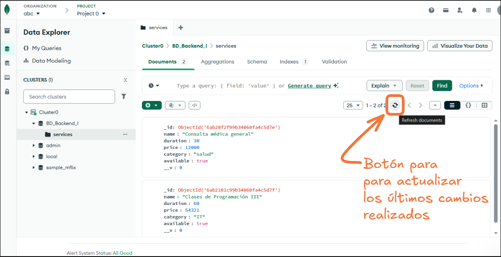

# Clase 6 · MongoDB Atlas y Mongoose

Curso de Programación Backend I - Coderhouse

## Iniciar

```bash
npm install
npm run dev
```

La API escucha en http://localhost:8080. 

**Importante:** Antes de iniciar, asegúrate de configurar la variable de entorno `MONGODB_URI` en el archivo `.env` con tu cadena de conexión de MongoDB Atlas.

## Cambios realizados en esta clase

### Persistencia en MongoDB para Services

En esta clase se actualizó la persistencia del recurso **services** de filesystem (archivos JSON) a **MongoDB** utilizando Mongoose como ODM.

**Cambios principales:**
- El **ID** ya no es generado por `randomUUID` en el service, sino que es generado **automáticamente por MongoDB** al crear un documento.
- El DAO de services (`src/dao/services.dao.js`) ahora usa métodos de Mongoose para interactuar con la base de datos.
- Se creó el modelo Mongoose en `src/models/services.models.js` que define la estructura de los documentos en la colección.

### Bookings (Reservas) - Sin cambios

El recurso **bookings** se mantuvo con persistencia en filesystem (archivos JSON) tal cual estaba en la clase anterior. Esto permite comparar ambos enfoques y apreciar mejor el cambio realizado en services.

**Invitación a la práctica:** Como ejercicio de repaso, te invitamos a aplicar en bookings lo mismo que se realizó en services respecto al cambio de persistencia a MongoDB.

## Métodos de Mongoose utilizados

### `find()`
Devuelve todos los documentos de una colección que coinciden con el filtro.

```javascript
const services = await Service.find().lean();
// Retorna: Array de objetos JavaScript planos con todos los servicios
```

### `findById(id)`
Busca un documento por su `_id` (identificador único de MongoDB).

```javascript
const service = await Service.findById(id).lean();
// Retorna: Objeto del servicio encontrado o null si no existe
```

### `create(data)`
Crea un nuevo documento en la colección y lo valida según el esquema.

```javascript
const newService = await Service.create(serviceData);
// Retorna: Documento Mongoose del servicio creado con su _id generado
```

### `findByIdAndUpdate(id, changes, options)`
Busca un documento por `_id` y lo actualiza con los cambios especificados.

```javascript
const updatedService = await Service.findByIdAndUpdate(id, changes).lean();
// Retorna: Objeto del servicio actualizado o null si no existe
```

### `findByIdAndDelete(id)`
Busca un documento por `_id` y lo elimina de la colección.

```javascript
const deletedService = await Service.findByIdAndDelete(id).lean();
// Retorna: Objeto del servicio eliminado o null si no existía
```

### `lean()`
Convierte documentos Mongoose a objetos JavaScript planos (sin métodos Mongoose). Se usa para obtener datos más ligeros y serializables.

## Cómo probar los endpoints con Postman

### Configuración
- Base URL: `http://localhost:8080`

### Ejemplos de datos para probar

Puedes usar los siguientes datos de ejemplo para probar los endpoints de services:

```json
[
  {
    "name": "Consulta médica general",
    "duration": 30,
    "price": 12000,
    "category": "salud",
    "available": true
  },
  {
    "name": "Sesión de fisioterapia",
    "duration": 45,
    "price": 15000,
    "category": "rehabilitación",
    "available": true
  },
  {
    "name": "Clases de Programación I",
    "duration": 60,
    "price": 54321,
    "category": "IT",
    "available": true
  }
]
```

### Endpoints disponibles

| Método | Endpoint | Descripción |
| --- | --- | --- |
| GET | `/api/services` | Obtener todos los servicios |
| GET | `/api/services/:id` | Obtener un servicio por ID (usar el _id de MongoDB) |
| POST | `/api/services` | Crear un nuevo servicio |
| PUT | `/api/services/:id` | Actualizar un servicio existente |
| DELETE | `/api/services/:id` | Eliminar un servicio |

**Nota:** Al crear un servicio con POST, MongoDB generará automáticamente el `_id`. Este ID aparecerá en la respuesta y deberás usarlo para las operaciones GET, PUT y DELETE.

## Ver datos en MongoDB Atlas



**Importante:** Cuando estés en la página de MongoDB Atlas y quieras ver los datos agregados, actualizados o eliminados, debes **refrescar la vista** ya que no suele actualizarse automáticamente. Esto puede hacer que parezca que los cambios no impactaron en la Base de Datos cuando en realidad sí lo hicieron.

El botón para refrescar se encuentra como se muestra en la imagen arriba.
